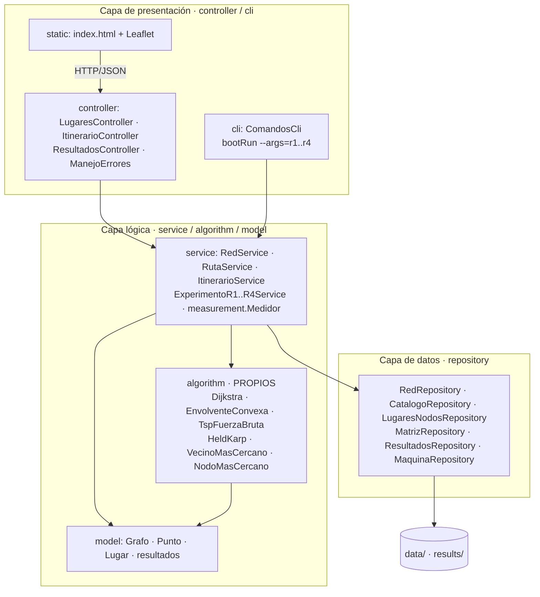
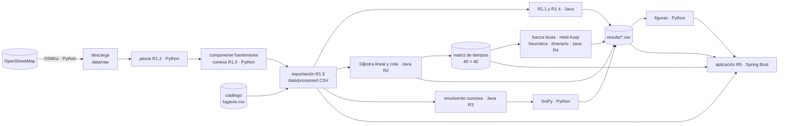

# 1. Arquitectura de la solución

## 1.1 Arquitectura en tres capas (Java, Spring Boot)

Paquete base `co.edu.uniquindio.rutas`. Dependencias en una sola dirección (presentación →
lógica → datos), comprobadas automáticamente con ArchUnit (`architecture.ArquitecturaTest`).
Los paquetes Java usan nombres en inglés: `controller`, `cli`, `service`, `algorithm`,
`model` y `repository`; el arnés de medición reside en `service.measurement`.

_(Describir cada capa: responsabilidad, qué usa de Spring y por qué los algoritmos propios no
dependen de ninguna librería ni de la capa de datos.)_

## 1.2 Flujo de datos entre Python, Java y los requerimientos

_(Describir cada componente: comando que lo ejecuta, entradas, salidas y qué requerimiento
consume su salida.)_
