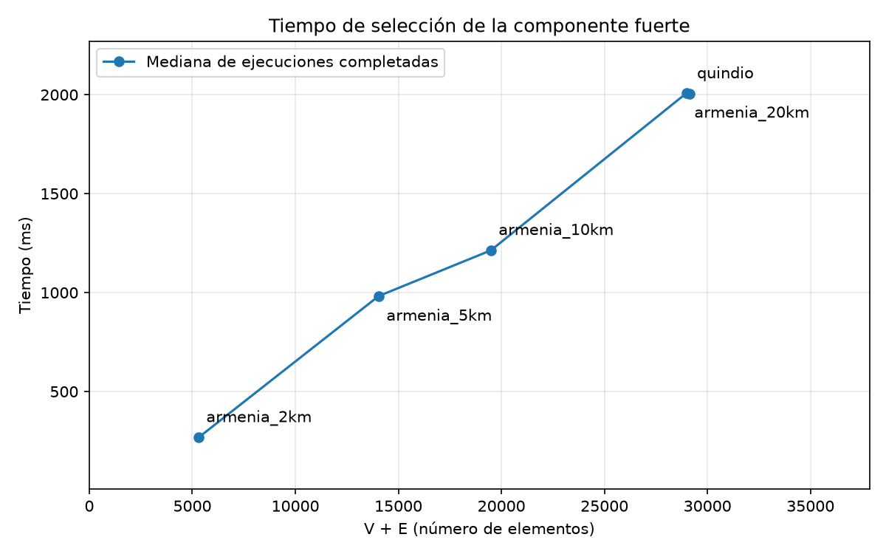

# 2. R1 — Modelo de la red vial

## 2.1 Problema

### Adquisición y conservación de la red

Se utiliza `ox.graph_from_place("Quindío, Colombia", network_type="drive",
retain_all=True, simplify=True)` en Python, como exige el enunciado. `drive` selecciona
vías para vehículos. `retain_all=True` evita que OSMnx seleccione de antemano únicamente
la componente débilmente conexa más grande: la selección de la componente fuerte se hará
explícitamente en R1.3. `simplify=True` aplica la simplificación topológica estándar de
OSMnx; la red obtenida no es el conjunto de todos los puntos geométricos originales de OSM.
La interpretación de estos parámetros se verificó en la documentación de OSMnx 2.1.1
(referencia en `docs/fuentes.md`).

El comando `python -m preparacion descargar` guarda un `MultiDiGraph` en
`data/raw/quindio.graphml` con `ox.save_graphml`. Este formato permite conservar sentidos,
vías paralelas, coordenadas, atributos y geometrías. En un atributo JSON del propio
archivo se guardan consulta, opciones, versiones, conteos y fecha UTC de adquisición.
Esta fecha no garantiza una instantánea histórica de OpenStreetMap porque OSMnx puede
reutilizar su caché HTTP; también se registra si dicha caché estaba habilitada.

Antes de publicar el archivo se escribe un temporal y se vuelve a leer con
`ox.load_graphml`, comprobando estructura y metadatos. Una ejecución posterior valida
y reutiliza el archivo sin tocar la fecha ni conectarse a internet. Si la copia no es
válida, se informa el error en lugar de eliminarla o sobrescribirla.

Los casos T1.D-a a T1.D-i verifican estas garantías sin peticiones HTTP: se simula la
respuesta de descarga y se prueba el formato GraphML real con OSMnx. Descargar no es
una medición de algoritmos. El procesamiento y la exportación ya están implementados;
el experimento de tiempos de R1.3 ya se ejecutó y verificó el 2026-11-11.

## 2.2 Representación (R1.1)

Se comparan dos modelos compactos, no el consumo real de objetos de la JVM:

- Matriz: dos pesos por par ordenado (tiempo y distancia), de 8 bytes cada uno:
  `B_matriz(V) = 16·V²`.
- Listas: cabecera de 8 bytes por nodo y entrada con destino de 4 bytes más dos pesos
  de 8 bytes: `B_listas(V,E) = 8·V + (4 + 8 + 8)·E = 8·V + 20·E`.
- MB decimales: `B / 1 000 000`. No son MiB. La cabecera de 8 bytes es un supuesto del
  modelo compacto, no una afirmación del tamaño real de referencias o arreglos Java.

La JLS de Java SE 21 (Oracle, 2023, §4.2) establece `int` de 32 bits y `double` binary64
(64 bits); su representación compacta motiva los 4 y 8 bytes. No fija con ello la
sobrecarga de objetos o referencias de una JVM concreta (fuente verificada en
`docs/fuentes.md`). No se incluyen identificadores OSM, coordenadas, geometrías,
encabezados de objetos, referencias por arista ni alineación. El `Grafo` usa arreglos de
referencias a objetos `Arista`, por lo que NO debe afirmarse que ocupa los MB calculados.

`gradlew.bat bootRun --args=r1` genera `results/r1/memoria_representacion.csv` con las
seis filas, sus supuestos y conteos. Tabla redondeada a seis decimales desde ese CSV:

| Red | V | E | Matriz (MB) | Listas (MB) |
|---|---:|---:|---:|---:|
| Descargada | 8877 | 20245 | 1260.818064 | 0.475916 |
| Componente exportada | 8791 | 20132 | 1236.506896 | 0.472968 |
| Grafo Java | 8791 | 19997 | 1236.506896 | 0.470268 |

Los conteos de las primeras dos versiones proceden de `metadatos.json`, comprobados
contra los CSV exportados para la componente. La última usa el grafo efectivamente
construido en Java: para cada par dirigido conserva la arista de menor tiempo.
Una celda con dos pesos no conserva todas las aristas paralelas; por eso las primeras
dos filas de listas incluyen alternativas que la matriz compacta no representa.
La comparación equivalente para los caminos mínimos es la del grafo Java deduplicado,
que mantiene juntos el tiempo y la distancia de la arista elegida, no mínimos separados.

**Elección:** listas de adyacencia. Para el grafo Java, `E/V² = 19997/8791² ≈ 0.000258755`
(cálculo derivado del CSV): solo una pequeña fracción de los pares tiene conexión.
La matriz reservaría espacio también para pares sin arista. Por conteo propio de
posiciones almacenadas, su espacio crece como Θ(V²), mientras las listas requieren
Θ(V + E). Recorrer los vecinos de salida de `u` con listas examina `grado_salida(u)`
entradas; hacerlo mediante una fila de matriz examina V celdas. Esto favorece las listas
en las relajaciones de Dijkstra sobre esta red dispersa. Una matriz permite consultar
directamente un par en O(1); las listas deben buscar entre sus vecinos. Estas conclusiones
se derivan de la representación y los conteos, no de mediciones de tiempo o memoria real.

La estimación hace un número fijo de operaciones por versión, sin construir una matriz
ni reservar memoria proporcional a su tamaño teórico. Se probaron cálculos manuales,
paralelas, productos cuadrados que exceden `int` y rechazo de metadatos inválidos antes
de sobrescribir las salidas. La lectura y validación de CSV quedan fuera de ese cálculo.

## 2.3 Pesos (R1.2)
Se conserva `length` como `longitud_m`. Los límites OSM positivos y finitos se interpretan
en km/h salvo unidad explícita mph, que se convierte. Para listas y valores separados por
punto y coma se toma el mínimo tras convertir: supuesto conservador, no reconstrucción
exacta de cada segmento original. Valores ambiguos se tratan como desconocidos.

Se usa `ox.routing.add_edge_speeds` (OSMnx 2.1.1, documentación y código consultados;
véase `docs/fuentes.md`) para imputar el promedio de límites conocidos del mismo tipo de
vía. Para tipos sin datos, el código de esta versión usa el promedio de los promedios
conocidos por tipo, no el promedio global ponderado por aristas. Si `highway` es una lista,
se toma su primer elemento, como OSMnx; se conserva el atributo original. No se introduce
una velocidad constante sin fundamento si toda la red carece de velocidades válidas: se
aborta. Las fuentes registradas son `osm`, `imputada` y `defecto`, respectivamente.

El peso se calcula como `tiempo_s = longitud_m × 3.6 / velocidad_kmh`, sin redondeo.
Por análisis dimensional, metros divididos entre metros/segundo dan segundos. Se exige
que longitudes, velocidades y tiempos sean finitos y positivos. La función devuelve una
copia ponderada sin cambiar el grafo original ni escribir archivos. Las pruebas usan
valores calculados a mano y OSMnx real, sin peticiones HTTP.

Este tiempo es una estimación del modelo: los límites señalizados no son velocidades
observadas y no se modelan tráfico, semáforos ni pendientes. La elección de la red y de
su clasificación también condiciona las rutas. En la red exportada, el 6,47 % de las
aristas conserva una velocidad válida procedente de OSM; el 93,53 % restante usa
imputación según la política descrita. El porcentaje procede de
`data/processed/metadatos.json` y caracteriza esta descarga, no todas las redes viales.

## 2.4 Componente fuertemente conexa (R1.3)

Se aplica `ox.truncate.largest_component(ponderada, strongly=True)`. OSMnx 2.1.1 primero
consulta `nx.is_strongly_connected`; si hace falta, enumera componentes, selecciona la de
mayor número de nodos con `max(..., key=len)` y construye una copia del subgrafo inducido.
Si la red ya es fuerte, devuelve el grafo recibido. Se respeta la implementación de la
librería, sin reimplementar SCC en Python.

La documentación y el código de NetworkX 3.7 describen una versión iterativa de Tarjan
con mejoras de Tarjan y Zwick (2024) y una técnica de WebGraph; referencias verificadas
en `docs/fuentes.md`. No corresponde atribuir a esta versión la variante de Nuutila de
versiones anteriores. El recorrido DFS mantiene números de visita y valores low-link,
que permiten detectar raíces de componentes y agrupar sus nodos pendientes. Las pilas
son explícitas, no llamadas recursivas de Python.

**Derivación del costo por inspección del código instalado:** cada nodo se visita y se
incorpora/retira de las estructuras de búsqueda un número constante de veces. Se recorren
sus adyacencias: O(V + E) tiempo y O(V) estado auxiliar para el recorrido. En el
multigrafo, la exploración de sucesores puede agrupar paralelas; O(V + E) sigue siendo
una cota superior respecto al número de aristas. La comprobación previa añade otro
recorrido lineal, `max` revisa los conjuntos disjuntos de nodos y la copia del subgrafo
cuesta O(Vc + Ec), acotado por O(V + E). El costo total de la función sigue siendo
O(V + E), suponiendo operaciones esperadas constantes en mapas/conjuntos. La memoria
incluyendo el grafo de salida es O(V + E); no confundirla con el estado O(V) del recorrido.
Esto es un análisis del código, no una complejidad declarada explícitamente en la página
de referencia. Los resultados reales se presentan a continuación; no prueban por sí
solos la cota teórica.

### Diseño experimental implementado

El comando `python -m preparacion r1` utiliza cuatro redes de `graph_from_point` desde
las coordenadas de `cab_armenia` del catálogo y la descarga departamental preservada.
Se especifican `dist=2000/5000/10000/20000`, `dist_type="bbox"`, `network_type="drive"`,
`retain_all=True` y `simplify=True`. Las zonas son cuadrados definidos por la distancia
del centro a sus límites, no círculos ni isócronas. No se descartan previamente las
componentes débiles. Los GraphML experimentales van a `data/raw/r1/`, separados de los
datos usados para planear rutas, con centro, opciones, conteos, versiones y adquisición UTC.

Antes de medir todas las redes, se comparan las particiones de componentes producidas
por NetworkX y Kosaraju, y se comprueba que OSMnx devuelve una componente de tamaño
máximo e inducida con todas las aristas paralelas. En un empate se acepta cualquiera
de las componentes máximas. La misma comprobación del resultado se repite después de
medir, fuera del cronómetro. Estas verificaciones no implementan SCC propia en Python.

`medir_con_limite` ejecuta la función OSMnx en un proceso `spawn` por serie, con un
calentamiento y cinco repeticiones, mediana en milisegundos. Cualquier ejecución
terminada de más de 60 s sustituye las muestras previas y detiene la serie; si excede
300 s se termina el hijo y se registra «no completada», sin tiempo. Descarga, lectura,
preparación, recolección de basura, serialización y verificación quedan fuera del
tiempo registrado. Se mide la función completa de OSMnx, incluyendo su comprobación
de conectividad y eventual copia, no exclusivamente el recorrido Tarjan.

Las tablas se generan en `results/r1/tamano_red.csv` y `tiempo_componente.csv`, con
V/E de entrada y sin deduplicar paralelas; `results/maquina_python.csv` identifica el
entorno. Los tamaños de la componente se obtienen en la verificación previa, incluso
si la medición posterior excede el límite. No se publican medianas parciales como si
hubieran completado la serie. Las cinco redes terminaron con cinco repeticiones medidas.
La adquisición y la verificación se realizan antes del experimento, sin ejecutar pruebas
simultáneamente a las mediciones.

Dentro de la componente existe camino dirigido entre cualquier par de nodos, por lo que
la matriz de tiempos no tendrá infinitos por falta de camino para lugares asociados a
esos nodos. Esto no garantiza proximidad de todos los lugares originales: el catálogo
ya fue asociado y verificado contra OSMnx, con cuatro alertas de más de 500 m que deben
explicarse, no eliminarse moviendo puntos sin evidencia de acceso.

| Red | Nodos | Aristas |
|---|---|---|
| Red departamental descargada | 8877 | 20245 |
| Componente fuertemente conexa departamental | 8791 | 20132 |

Fuente: `results/r1/tamano_red.csv`, generado por `python -m preparacion r1`.

| Red | V | E | V + E | Tiempo (ms) |
|---|---|---|---|---|
| Bbox de 2 km | 1653 | 3649 | 5302 | 267.5 |
| Bbox de 5 km | 4320 | 9726 | 14046 | 982.4 |
| Bbox de 10 km | 6002 | 13486 | 19488 | 1213.2 |
| Bbox de 20 km | 8849 | 20139 | 28988 | 2008.3 |
| Departamento completo | 8877 | 20245 | 29122 | 2004.8 |

Fuente: `results/r1/tiempo_componente.csv`; medianas de cinco repeticiones, estado
`completada` en todas las filas. Entorno: `results/maquina_python.csv`.
Los tiempos aumentan en general con V+E, pero el departamento es ligeramente más
rápido que bbox de 20 km pese a tener más nodos/aristas. Esto no contradice una cota
asintótica: intervienen la forma de la red, atributos copiados y variabilidad de ejecución.
La red de 20 km y la departamental tienen tamaños muy cercanos (8849 frente a 8877 nodos),
por lo que aportan dos observaciones de escala similar, no dos incrementos independientes
del tamaño. Se conservan ambas porque el enunciado fija esos radios y la red departamental.
La cercanía de los conteos no implica que las dos zonas tengan idéntica cobertura.

| Red | Tiempo/(V+E) (ms por elemento) |
|---|---:|
| Bbox de 2 km | 0.0504 |
| Bbox de 5 km | 0.0699 |
| Bbox de 10 km | 0.0623 |
| Bbox de 20 km | 0.0693 |
| Departamento completo | 0.0688 |

El cociente no es constante en estas cinco muestras, pero se mantiene en el mismo
orden de magnitud. Estos cocientes se calculan con los tiempos sin redondear del CSV,
no con las cifras de un decimal de la tabla de presentación.

La figura se genera desde `results/r1/tiempo_componente.csv` con
`python -m preparacion graficas`. Los dos puntos superiores representan redes de tamaño
similar; no permiten concluir un cambio de tendencia asintótica. El rango de cocientes
y el número limitado de redes son compatibles con crecimiento lineal, sin demostrarlo.

### Exportación de la componente (R1.5)

`procesar` lee únicamente la copia cruda validada; no realiza peticiones de descarga.
Asigna pesos antes de seleccionar la componente, de modo que la imputación utiliza la
red descargada. Ordena los identificadores OSM y les asigna índices contiguos, conserva
el identificador original y proyecta coordenadas a UTM 18N con pyproj. Ordena también
las aristas y exporta las columnas acordadas con `RedRepository`, sin eliminar paralelas.
El ordenamiento añade O(V log V + E log E) al procesamiento: no se incluye al medir SCC.
Los atributos `highway` múltiples se serializan unidos por `|`.

Los metadatos conservan la procedencia original y añaden conteos de componente y el
porcentaje de velocidades OSM sobre las aristas exportadas. `Grafo` deduplica después
las paralelas por menor tiempo en Java; sus conteos no deben confundirse con filas CSV.
Los lugares con coordenadas completas se proyectan; si faltan todas, se exporta solo la
cabecera y se avisa, sin completar coordenadas artificialmente ni declarar válido el
catálogo. Las tablas anteriores proceden del comando experimental de R1.3.

## 2.5 Ubicación de los lugares (R1.4)

### Búsqueda del nodo más cercano

`algorithm.NodoMasCercano.buscar` recorre los nodos de la red y calcula su distancia
euclidiana al lugar, usando coordenadas UTM 18N en metros. Conserva el índice y la
distancia del mejor nodo encontrado. La red de entrada es no vacía y sus arreglos de
coordenadas tienen igual longitud. No modifica dichos arreglos.

Para un nodo de coordenadas `(xs[i], ys[i])` y un lugar `(x, y)`, calcula
`d = Math.hypot(xs[i] - x, ys[i] - y)`. Esta operación devuelve
`sqrt(dx² + dy²)` sin desbordamiento o subdesbordamiento intermedio, según Oracle
(documentación de Java SE 21, `Math.hypot`; enlace en `docs/fuentes.md`). La búsqueda es
propia: `Math.hypot` solo proporciona la operación numérica, no selecciona el nodo.

**Invariante:** después de examinar los nodos de índices `0..i`, el índice guardado es el
menor índice entre los de mínima distancia en ese prefijo, y la distancia guardada es la
suya. Es cierto al inicializar con el nodo 0. Al visitar el siguiente nodo se actualiza
solo si su distancia es estrictamente menor; si empata, se conserva el índice anterior,
que es menor. Al terminar, el prefijo contiene toda la red y el resultado es correcto.

**Análisis propio de complejidad:** bajo el modelo de costo constante para operaciones
con valores `double` de tamaño fijo, hay una inicialización de costo `a`, `V - 1`
iteraciones de costo acotado por constantes y una construcción final de costo `b`.
Por tanto, existen constantes positivas `c1` y `c2` tales que
`a + c1·(V - 1) + b ≤ T(V) ≤ a + c2·(V - 1) + b`: tiempo **Θ(V)** en todos los casos.
Solo se mantienen variables escalares y un resultado de tamaño fijo: memoria auxiliar
**Θ(1)**. Para `L` lugares, repetir esta búsqueda cuesta **Θ(L·V)**. No hay recursión.

La verificación unitaria cubre T1.4-a a T1.4-f: ejemplo manual, empates, un solo nodo,
50 consultas sobre 500 nodos generados con semilla 2026, coincidencia exacta y empate
entre índices posteriores al primero. No son mediciones de rendimiento.

### Asociación y verificación con datos reales

`gradlew.bat bootRun --args=r1` genera las asociaciones con la búsqueda Java; no mide
tiempos. `python -m preparacion verificar-lugares` construye un grafo de nodos UTM y
consulta `ox.distance.nearest_nodes` sin descargar datos. Antes exige que las coordenadas
UTM correspondan al catálogo actual, y comprueba después índice, distancia y bandera del
umbral. Se exige igualdad de índices; un empate resuelto de otra manera por la librería
se reportaría como discrepancia, sin modificar el resultado propio.

En `results/r1/verificacion_lugar_nodo.csv` coinciden los 40 lugares. El archivo
`results/r1/lugares_lejanos.csv` contiene las siguientes distancias (redondeadas aquí a
dos decimales) y sus notas de tratamiento:

| Lugar | Distancia al nodo (m) |
|---|---:|
| Valle de Cocora | 925.45 |
| RECUCA | 564.30 |
| Combia | 707.76 |
| El Agrado | 670.15 |

La coincidencia verifica el cálculo de nodo más cercano, no la accesibilidad del predio.
Las limitaciones de los cuatro casos se describen a continuación y se conservan en los
CSV; no se afirma que exista una vía excluida sin evidencia de sus etiquetas.

La integración conserva el orden del catálogo, copia una vez las coordenadas del grafo
y guarda una fila por lugar. Por conteo propio, además del costo Θ(L·V) de las búsquedas,
requiere O(V + L) espacio auxiliar para copias y filas, sin contar el grafo ya cargado.
Esto no contradice la memoria Θ(1) de una búsqueda individual.

### Tratamiento de las alertas y alcance del modelo

Se mantienen los cuatro puntos y sus asociaciones, sin insertar conexiones artificiales:

- **Cocora:** el punto de llegada está cerca de la vía incluida «Salento - Valle de
  Cocora», pero separado de los extremos de la arista simplificada. Sus vértices
  geométricos intermedios no son nodos consultables por la búsqueda Java.
- **RECUCA:** se utiliza el marcador general del atractivo. La vía «Calle Larga» está
  incluida; la proximidad a su geometría no implica proximidad a un nodo.
- **Combia:** se utiliza el parqueadero. La distancia al nodo es una separación
  geométrica, no una longitud de recorrido por el acceso a la hacienda.
- **El Agrado:** se utiliza la ubicación de la finca, cuyo marcador no distingue la
  entrada de recepción de café. Se conserva el nodo asociado y se reporta la distancia.

Las coordenadas son las revisadas en mapa por el grupo. Esa revisión no equivale a un
levantamiento de accesos ni a una comprobación de operación actual de los predios.
No se atribuyen etiquetas `track` o `service` a accesos particulares sin datos que lo
sustenten. Una alerta geométrica por sí sola no demuestra que `drive` haya excluido la vía.

La asociación formal sigue siendo al nodo más cercano, como exige R1.4. La distancia
a una línea vial solo se utilizó como diagnóstico con librerías sobre UTM. No reemplaza
la alerta de más de 500 m ni incorpora tiempo del último acceso al modelo. Los tiempos
de ruta serán entre nodos asociados, no una garantía de recorrido puerta a puerta.

## 2.6 Grafo procesado (R1.5)
