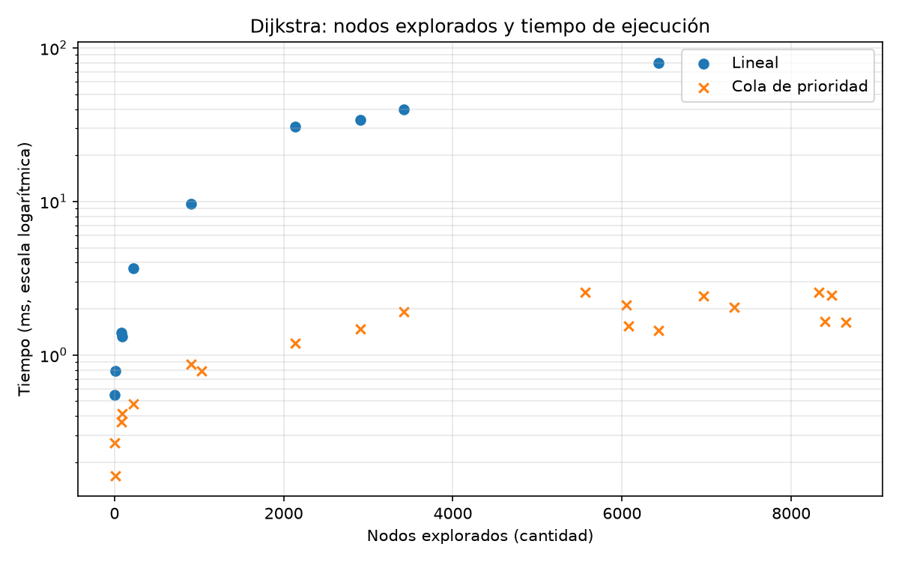

# 3. R2 — Caminos mínimos

## 3.1 Problema

Se busca el camino de menor tiempo entre dos nodos asociados a lugares del catálogo,
respetando sentidos de circulación. El peso es `tiempo_s`, no distancia geométrica.
Se implementan en Java dos variantes propias de Dijkstra sobre el mismo `Grafo` con
listas de adyacencia. Ambas devuelven tiempo, ruta, nodos fijados y distancias tentativas
al terminar. Sin destino se calculan todas las distancias; ese modo construye la matriz
usada posteriormente en R4.

La versión lineal selecciona el menor valor entre todos los nodos no fijados mediante
un recorrido del arreglo. La versión con cola utiliza `PriorityQueue` como estructura
de apoyo, con entradas `(distancia, nodo)` y borrado perezoso: una mejora inserta una
nueva entrada, y una extracción de un nodo ya fijado se descarta sin volver a contarlo.
Ambas desempatan por menor índice y actualizan el predecesor solo ante mejora estricta.

## 3.2 Complejidad

| Versión | Tiempo | Memoria | Fuente |
|---|---|---|---|
| Recorrido lineal | O(V² + E), equivalente a O(V²) en el grafo deduplicado | O(V) auxiliar | Derivación propia; selección/relajación de Sedgewick y Wayne, §4.4 |
| Cola de prioridad, borrado perezoso | O(V + E log(E + 1)), acotado por O((V + E) log V) para V ≥ 2 | O(V + E) auxiliar | Derivación propia con costos de `PriorityQueue` (Oracle, Java SE 21) |

**Lineal.** Sean k los nodos fijados, Eᵣ las aristas examinadas y r la longitud de la ruta.
Inicializar arreglos cuesta a·V; cada selección recorre V posiciones y las relajaciones
examinan las aristas de los nodos fijados. Una cota de ejecución es
`T(V,k,Eᵣ,r) ≤ a·V + b·(k+1)·V + c·Eᵣ + d·r + e`, para constantes positivas.
Como k ≤ V, Eᵣ ≤ E y r ≤ V, resulta O(V² + E). `Grafo` conserva una sola arista por
par dirigido, por lo que E ≤ V², incluso admitiendo bucles. En el peor caso conectado
sin parada anticipada se hacen V selecciones de V candidatos: Θ(V²). Con origen igual
destino basta una selección, pero la inicialización mantiene un costo Θ(V).

**Cola.** Hay como máximo Eᵣ relajaciones exitosas, Eᵣ+1 inserciones y otras tantas
extracciones. El Javadoc oficial de Java SE 21 declara `offer` y `poll` O(log n) y
`size` O(1) (Oracle). La cola puede guardar O(E) entradas, no solo O(V), porque no se
realiza `decrease-key`. Por conteo:
`T ≤ a·V + b·Eᵣ + c·(Eᵣ+1)·log(Eᵣ+2) + d·r + e`.
De ahí O(V + E log(E+1)); como E ≤ V², se obtiene la cota pedida
O((V+E) log V) para V ≥ 2. No se usa `remove(Object)`, que tiene costo lineal.

En ambas variantes los arreglos de distancias, predecesores y fijados requieren O(V).
Reconstruir sigue los predecesores hacia atrás y crea un arreglo en orden inverso:
O(r) tiempo amortizado y O(r) memoria. `ArrayList.add` tiene costo amortizado constante
y `get` constante según Oracle. La cola añade O(E) memoria; el grafo de entrada no se
incluye como memoria auxiliar. Los métodos son iterativos, sin costo de pila recursiva.

Las cotas corresponden a estas implementaciones, no a una librería de grafos usada
para resolver el problema. Sedgewick y Wayne describen una cola indexada con diferente
contabilidad de memoria; aquí se deriva expresamente el costo del borrado perezoso.

## 3.3 Correctitud

**Invariante.** Al comenzar una selección, todo nodo fijado u tiene distancia definitiva
δ(origen,u). Para cada nodo no fijado v, `dist[v]` es el menor costo conocido de un
camino cuyos nodos intermedios ya fueron fijados, o infinito si no se conoce uno.

**Inicialización.** Solo el origen tiene distancia cero; los demás tienen infinito y
no hay nodos fijados. El camino vacío al origen es óptimo con pesos no negativos.

**Mantenimiento.** Sea u el candidato no fijado de menor distancia. Si existiera un
camino más corto al mismo u, el primer nodo no fijado de ese camino habría recibido,
al relajar desde su predecesor fijado, una distancia no mayor que la de ese camino.
Con pesos no negativos no podría superar la distancia de llegada a u. Esto contradice
la elección del mínimo. Por tanto `dist[u]` es definitiva. Relajar sus salidas actualiza
precisamente los caminos permitidos al ampliar el conjunto fijado, manteniendo el
invariante. En la cola siempre se conserva una entrada con la mejor distancia de cada
candidato alcanzable; las entradas obsoletas no alteran la selección válida.

**Terminación.** Al fijar el destino su distancia ya es óptima, por lo que se puede
parar antes de relajar sus salidas. Si no queda candidato finito, los demás nodos son
inalcanzables. La matriz requiere el modo sin destino: con parada temprana las otras
distancias pueden ser todavía tentativas. La cadena de predecesores conserva aristas
de las mejoras y reconstruye una ruta con el costo registrado.

**Pesos negativos.** Considérese 0→1 con peso 2, 0→2 con peso 3 y 2→1 con peso -2.
Se fijaría 1 con costo 2 antes de descubrir la ruta 0→2→1 de costo 1. Dijkstra con
fijación y parada temprana no es válido en ese caso; corresponde otro método, como
Bellman-Ford. El modelo rechaza negativos y pesos no finitos al construir el grafo;
admite pesos cero. Un desbordamiento en la suma se informa como error, no como un
destino inalcanzable.

**Elementos voraces.** Candidatos: nodos no fijados alcanzables. Selección: menor
distancia tentativa. Factibilidad: camino dirigido desde el origen y nodo no fijado.
Solución: distancias definitivas y predecesores. Objetivo: minimizar la suma de tiempos.
La elección es segura por el invariante; la subestructura óptima se observa porque
todo subcamino de un camino mínimo también es mínimo entre sus extremos (si no, podría
reemplazarse y mejorar el camino completo).

## 3.4 Verificación

Los casos de la guía 08 comprueban distancias y rutas manuales; las pruebas cubren
asimetría, destino inalcanzable, origen igual destino, parada temprana, pesos cero,
empates y descarte de entradas obsoletas. En grafos dirigidos generados con semilla
2026 se contrastan ambas variantes con un Bellman-Ford independiente en las pruebas.
Se verifican además los costos de sus rutas y las distancias completas.

Antes de medir en la red real se validan asociaciones y matriz, se comprueban rutas
para los veinte pares y se comparan las dos versiones en los diez comunes. Después de
medir se valida de nuevo cada resultado terminado. `results/r2/verificacion.csv`
registra diez coincidencias entre versiones, con tolerancia absoluta 1e-6 s.

La verificación externa lee los CSV procesados en un `MultiDiGraph` de NetworkX 3.7,
sin descargar ni alterar datos. Se comprueban los treinta resultados medidos, incluidos
sus caminos y costos, y las 1600 celdas de la matriz. Todas las comparaciones coinciden:
`verificacion_networkx.csv` y `verificacion_matriz_networkx.csv` contienen la evidencia.
Las rutas no necesitan ser idénticas a una ruta elegida por la librería si existen empates;
sí deben ser válidas y tener el costo mínimo. NetworkX solo verifica: la matriz usada
por el proyecto se produce en Java.

## 3.5 Resultados

### Diseño experimental

Se ordenan los lugares por ID, se generan pares dirigidos con nodos distintos y se
separan por municipio. Se baraja primero la lista intramunicipal y luego la intermunicipal
con una instancia `Random(2026)` y se toman diez de cada una. En `pares.csv` se conservan
IDs, nodos, municipios, criterio y semilla. Es un muestreo reproducible por criterio,
no una selección de los diez caminos más cortos ni una representación equilibrada de
todos los municipios.

Se ejecutó `gradlew.bat bootRun --args=maquina` y después `--args=r2` el 2026-11-12.
`results/maquina_java.csv` registra Java 21.0.10, JVM OpenJDK de Amazon, Windows y un
máximo de 2048 MB de heap. Se desactiva la optimización de arranque de `bootRun`;
padre e hijas usan heap inicial/máximo fijo y pila configurada según el protocolo.
Cada consulta y versión tiene una JVM hija propia: un calentamiento y cinco repeticiones,
mediana en ms. Se incluye búsqueda y reconstrucción de ruta, excluyendo lectura,
construcción, serialización, arranque, verificación e impresión. El límite se vigila por
ejecución; no hubo timeouts ni se activó la excepción de una sola ejecución >60 s.

### Comparación sobre los diez pares comunes

| Origen → destino | Nodos explorados | Lineal (ms) | Cola (ms) |
|---|---:|---:|---:|
| cab_pijao → ac_coocafeq_pijao | 3 | 0.548 | 0.267 |
| fh_san_alberto → cab_buenavista | 14 | 0.784 | 0.164 |
| fh_mirador_palmas → fh_mocawa_resort | 78 | 1.404 | 0.367 |
| atr_parque_cafe → ac_central_el_agrado | 94 | 1.328 | 0.413 |
| cab_calarca → atr_recuca | 6433 | 80.240 | 1.451 |
| atr_parque_vida → cab_armenia | 906 | 9.643 | 0.868 |
| fh_mirador_palmas → cab_la_tebaida | 222 | 3.682 | 0.483 |
| ac_coocafeq_calarca → fh_combia | 3417 | 39.884 | 1.919 |
| ac_coocafeq_armenia → atr_parque_vida | 2904 | 34.157 | 1.473 |
| atr_parque_fundadores → atr_museo_oro_quimbaya | 2136 | 30.833 | 1.194 |

Fuente: `results/r2/mediciones_dijkstra.csv`. Son medianas de cinco repeticiones,
redondeadas aquí a tres decimales para no ocultar los tiempos inferiores a 1 ms. Ambas
versiones fijan igual cantidad de nodos en cada par común, pero difieren en el costo de
seleccionar el siguiente nodo. Los otros diez pares, medidos solo con cola, permanecen
en el CSV completo.

El cociente se calcula por par usando los tiempos sin redondear: `mediana_lineal_ms /
mediana_cola_ms`. Los siguientes valores resumen esos diez cocientes, no son un cociente
entre medianas globales:

| Mediana | Mínimo | Máximo |
|---|---|---|
| 9.37 | 2.05 | 55.29 |

Fuente: `results/r2/cociente.csv`. En esta serie la cola fue más rápida en los diez
pares comunes. La variación del cociente muestra que no existe una aceleración fija
para todas las consultas.

La figura se genera desde el CSV de mediciones con `python -m preparacion graficas`.
El eje vertical usa escala logarítmica para distinguir los tiempos de la cola sin
perder la comparación con la versión lineal; distancias verticales iguales representan
factores iguales, no incrementos iguales de ms. «Nodos explorados» corresponde a la
columna `nodos_explorados`: nodos fijados por primera vez, incluido el destino; las
extracciones obsoletas de la cola no cuentan. No son curvas de T(V) variando el tamaño
del grafo: V permanece fijo y cambia cuánto se explora antes de alcanzar el destino.

### Tiempo lineal normalizado por k·V

Para consultas con destino alcanzable, cada uno de los k nodos explorados exige un
barrido completo de V posiciones en la selección lineal. Se calcula
`q = T_ms · 10⁶ / (k·V)`, expresado en ns por posición. El mismo comando `graficas`
genera `results/r2/normalizacion_lineal.csv` desde las mediciones existentes y el
V de `grafo_java` en `results/r1/memoria_representacion.csv`, sin volver a medir.
En esta red V = 8791. Se conservan todas las consultas lineales:

| Nodos explorados k | T/(k·V), ns por posición |
|---:|---:|
| 3 | 20.779 |
| 14 | 6.370 |
| 78 | 2.048 |
| 94 | 1.607 |
| 222 | 1.887 |
| 906 | 1.211 |
| 2136 | 1.642 |
| 2904 | 1.338 |
| 3417 | 1.328 |
| 6433 | 1.419 |

Fuente: `results/r2/normalizacion_lineal.csv`, valores redondeados a tres decimales.
En las seis consultas con k ≥ 200, q queda entre 1.21 y 1.89 ns por posición. Su
relativa estabilidad respalda el predominio del barrido lineal en esas consultas.
El umbral 200 describe este conjunto de observaciones, no una frontera teórica ni
un criterio para descartar las consultas pequeñas. El numerador incluye todo el
algoritmo y la reconstrucción: q no mide aisladamente el costo de una posición.

## 3.6 Matriz de tiempos

Se ejecuta la versión con cola sin destino una vez por lugar. Para L lugares,
`M[i][j] = distancias[nodo_j]` desde `nodo_i`: costo superior
O(L·(V+E) log V + L²), por aplicar L veces la cota anterior y extraer L² valores.
La rutina de construcción conserva la matriz O(L²) y el estado de una búsqueda
O(V+E); no almacena todos los recorridos entre todos los pares.

`results/r2/matriz_tiempos.csv` tiene 40 × 40 celdas finitas, diagonal cero y segundos
con tres decimales, en el mismo orden de IDs en filas y columnas. No es simétrica:
los sentidos y pesos dirigidos hacen que ir y regresar puedan costar distinto.
La verificación externa admite 0.0005001 s absolutos por el redondeo al guardar cada
celda; los resultados medidos conservan `double` y se comparan con 1e-6 s.
R4 utilizará esta matriz redondeada, no una matriz recalculada por NetworkX.

## 3.7 Discusión

La red vial es dispersa y las listas permiten examinar solo salidas existentes. La
versión lineal, aunque pare al fijar el destino, vuelve a recorrer las V posiciones
en cada selección; la cola evita ese barrido a cambio de operaciones de montículo y
entradas obsoletas. Los resultados son consistentes con ese mecanismo, no una prueba
experimental de las cotas asintóticas.

La normalización anterior refuerza la comparación con el modelo de operaciones. Para
un destino alcanzable hay exactamente k barridos de V posiciones: Ω(k·V). A esto se
añaden inicialización O(V), aristas examinadas O(Eᵣ) y reconstrucción O(r). Como k ≥ 1,
r ≤ k y, al deduplicar aristas, Eᵣ ≤ k·V, resulta Θ(k·V) para esta implementación en
el modelo de costo por operación. Es una derivación del código; la estabilidad
empírica del cociente no demuestra por sí sola esa cota ni la generaliza a otras JVM.

En las consultas pequeñas ambas versiones asignan tres arreglos de tamaño V
(distancias, predecesores y fijados), con inicialización de costo Θ(V) independiente
de k. Este costo común ayuda a explicar que la ventaja relativa de la cola sea menor
en varios pares cortos y que T/(k·V) aumente al disminuir k: un término a·V aporta
a/k al cociente. Para k=3 y k=14 se observan respectivamente 20.779 y 6.370 ns por
posición. No se midió la inicialización por separado, por lo que no puede afirmarse
que sea por sí sola el costo dominante; también intervienen asignaciones, JIT y ruido
del sistema. El mínimo observado con cola fue 0.164 ms (CSV de mediciones), no un piso
universal de 0.2 ms.

Mismo municipio no garantiza cercanía por la red dirigida: Calarcá→RECUCA fija 6433
nodos y tarda más con lineal que otros pares intramunicipales. Se conserva ese caso
porque cumple el criterio declarado; no se sustituyó para mejorar la comparación.
Los tiempos con cola tampoco son monótonos en nodos explorados: influyen el número de
aristas relajadas, el tamaño de la cola, la longitud de la ruta, el JIT y el ruido del
sistema. Un solo calentamiento y cinco repeticiones cumplen el protocolo, pero no
constituyen un estudio exhaustivo de estabilidad de la JVM.

No se cronometra NetworkX ni se comparan velocidades entre Java y Python en R2. Las
mediciones son de ejecución del algoritmo, no el tiempo de viaje estimado de una ruta.
Este último hereda las limitaciones del modelo vial y de las velocidades imputadas
explicadas en R1; no incluye un último acceso fuera del grafo.

### Fuentes

- Sedgewick y Wayne, sitio de *Algorithms, 4th edition*, §4.4, «Shortest Paths»:
  https://algs4.cs.princeton.edu/44sp/ (selección, relajación y pesos no negativos).
- Oracle, Java SE 21, Javadoc de `PriorityQueue` y `ArrayList` (costos de apoyo):
  https://docs.oracle.com/en/java/javase/21/docs/api/java.base/java/util/PriorityQueue.html
  y https://docs.oracle.com/en/java/javase/21/docs/api/java.base/java/util/ArrayList.html.
- NetworkX 3.7, `single_source_dijkstra_path_length`, usada solo como oráculo:
  https://networkx.org/documentation/stable/reference/algorithms/generated/networkx.algorithms.shortest_paths.weighted.single_source_dijkstra_path_length.html.

Fuentes consultadas el 2026-11-12; alcance y versiones registrados en `docs/fuentes.md`.
