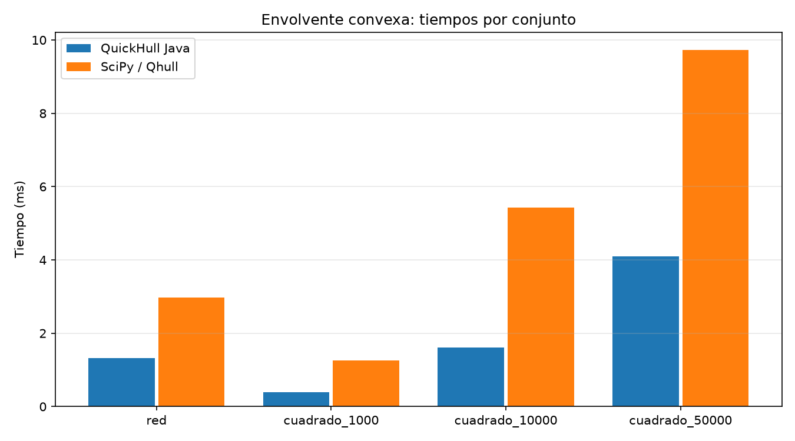

# 4. R3 — Envolvente convexa

## 4.1 Problema y preparación de coordenadas

La envolvente convexa es el menor conjunto convexo que contiene los nodos de la
componente vial, tratados como puntos del plano. Su borde aproxima la extensión de
esa red: no es el límite administrativo del Quindío ni un recorrido vial.

Se utilizan las coordenadas UTM 18N exportadas en R1. Java aproxima cada componente
con `Math.floor(v+0.5)` y elimina repetidos conservando el orden de aparición. Todo
esto ocurre antes de medir. Los puntos `Punto(long x, long y)` tienen coordenadas
enteras de 64 bits; el producto cruz permite decidir giros sin tolerancias flotantes:

`orientacion(a,b,p) = (bx−ax)(py−ay) − (by−ay)(px−ax)`.

Un resultado positivo indica izquierda, negativo derecha y cero colinealidad.
Las operaciones exactas de `Math` detectan un desbordamiento en lugar de ocultarlo.
El experimento valida un rango por eje de hasta 10⁹ m: las diferencias están acotadas
por ese rango y el valor absoluto del cruz por 2·10¹⁸, que cabe en `long`.

Los vértices se devuelven en sentido antihorario (CCW), comenzando por el menor `(x,y)`,
sin repetirlo al final. Un punto alineado en medio de un lado no cuenta como vértice.
Sin puntos se devuelve lista vacía; con un solo punto distinto, ese punto; con todos
colineales, los dos extremos lexicográficos. La entrada no se modifica.

## 4.2 Algoritmo elegido y justificación según la distribución de los puntos

Se eligió **QuickHull 2D**, un algoritmo de divide y vencerás. La red concentra nodos
en vías y cascos urbanos; se esperaba que muchos fueran interiores al casco. Los
datos finales apoyan esa elección: la envolvente de 8791 puntos tiene 14 vértices
(`results/r3/envolvente.csv`). Con pocos vértices extremos, QuickHull puede descartar
gran parte de los puntos interiores en los primeros niveles.

1. Recorrer la entrada para encontrar los extremos lexicográficos A y B.
2. Separar candidatos a la derecha de A→B (cadena inferior) y B→A (superior).
3. Para un segmento a→b, elegir el punto p más alejado por producto cruz (menor valor
   negativo; no hace falta dividir por la longitud del segmento ni calcular raíces).
   En empate se elige el menor `(x,y)`, haciendo la selección determinista.
4. Dividir los candidatos entre los exteriores a a→p y a p→b. Descartar el triángulo
   interior y los colineales. Resolver ambos subproblemas en ese orden.
5. Si no quedan candidatos, agregar b a la cadena. Concatenar inferior y superior
   y quitar el mínimo repetido al final.

Se usa una copia de referencias a los puntos y se particiona intercambiando posiciones
dentro de rangos disjuntos. Esto evita ordenar globalmente y crear listas de candidatos
por nivel. La implementación está en `algorithm.EnvolventeConvexa`.

**Correctitud.** Los extremos A y B pertenecen al casco. Para un segmento con candidatos
en su lado exterior, la recta paralela que pasa por el punto más alejado es de soporte;
elegir un extremo lexicográfico entre puntos empatados evita conservar un punto interior
de ese lado de soporte. El pivote pertenece al casco. Ningún punto dentro del triángulo
a-p-b puede ser un nuevo vértice extremo. Los únicos candidatos restantes están en
los dos subproblemas exteriores, disjuntos por la elección del más alejado. Por inducción
en su tamaño, las dos llamadas devuelven las cadenas correctas; sin candidatos, a→b
ya es un lado válido. Recorrer primero la cadena inferior y luego la superior da CCW.
Las desigualdades estrictas excluyen puntos intermedios colineales. Cada llamada
no vacía elimina al menos su pivote de los candidatos, por lo que la recursión termina.

## 4.3 Recurrencia y complejidad (tiempo y memoria, con fuente)

La idea corresponde a QuickHull (Barber, Dobkin y Huhdanpaa, 1996; manual de Qhull).
Las cotas siguientes se derivan de los barridos y particiones de nuestra variante 2D.

Para m candidatos de un subproblema, buscar pivote y hacer las dos particiones exige
un número constante de barridos. Con constantes positivas c y d:

`T(m) ≤ T(m₁) + T(m₂) + c·m + d`, con `m₁+m₂ ≤ m−1` y `T(0)=Θ(1)`.

La copia inicial, validación de null y búsqueda de extremos requieren Θ(n). No se
ordenan los puntos dentro ni fuera del algoritmo.

| Situación | Tiempo | Justificación |
|---|---|---|
| Mejor caso, descarte rápido; por ejemplo, puntos colineales | Θ(n) | Barridos iniciales obligatorios y ningún subproblema creciente |
| Modelo de particiones equilibradas sin descarte importante | O(n log n) | Cota por `T(m)=2T(m/2)+O(m)` |
| Promedio para una distribución de entradas de tamaño n | E[T]=O(n·E[h]), acotado por O(n²) | Derivación propia por niveles; no se presupone una ley para h |
| Peor caso, particiones muy desequilibradas | O(n²) | Expansión de `T(m)≤T(m−1)+c·m+d` |

En el modelo equilibrado, el Teorema Maestro de la guía 07 usa a=2, b=2, d=1 y
`log_b(a)=1`: el caso de igualdad da O(n log n). Es un modelo de reparto, **no** una
garantía promedio universal. En general los tamaños m₁ y m₂ no son m/2, así que el
Teorema Maestro no se aplica directamente. Para la cota desfavorable se expande:

`T(m) ≤ T(0) + c·(m+(m−1)+…+1) + d·m = O(m²)`.

Una cota sensible a la salida es O(n·h): los rangos de un mismo nivel son disjuntos
y suman a lo más n candidatos; cada llamada no vacía incorpora un vértice extremo
distinto, de modo que hay O(h) niveles como máximo. Por tanto, para una distribución
de entradas de tamaño n, tomar esperanza da `E[T] ≤ C·n·E[h]+C'·n`. Para n≥1, h≥1,
esto es O(n·E[h]) y, usando h≤n, O(n²).

Para un modelo con E[h]=O(log n), la misma derivación da E[T]=O(n log n), sin
necesitar particiones equilibradas. La revisión bibliográfica del modelo uniforme
continuo en un cuadrado queda identificada en `docs/fuentes.md` como pendiente de
consulta del artículo original de Rényi y Sulanke. El generador del experimento usa
una cuadrícula entera fija; su distribución se distingue de ese modelo continuo.

La aritmética es sobre `long` de tamaño fijo y cada giro cuesta O(1) en ese modelo.
La copia ocupa O(n), la salida O(h), y cada llamada mantiene solo índices, puntos y
valores escalares. Si la profundidad es D, la pila ocupa O(D): típicamente logarítmica
en el modelo equilibrado, pero O(n) como límite general. Memoria total
`O(n+h+D)=O(n)` porque h,D≤n (con casos pequeños constantes). Se configura `-Xss16m`;
las entradas adversarias con profundidad lineal pueden agotar la pila disponible.

## 4.4 Verificación contra SciPy

JUnit comprueba giros, cuadrado con colineales, triángulo con puntos interiores,
degenerados, duplicados, empates, segmentos verticales, entrada intacta y errores
numéricos. Nubes aleatorias y puntos próximos a una circunferencia se contrastan
con una cadena monótona independiente de Andrew como oráculo de pruebas.

El servicio verifica **todos** los conjuntos antes de medir: pertenencia y unicidad
de vértices, mínimo primero, giros estrictos CCW y todos los puntos en el semiplano
interior de cada lado. Este certificado geométrico O(n·h) está fuera del reloj. Tras
cada serie completada se exige exactamente la misma lista que en la verificación previa.

Java exporta puntos y vértices en `results/r3/`. Python construye un arreglo NumPy
float64 con esos mismos puntos y usa `scipy.spatial.ConvexHull` como referencia.
Antes de medir SciPy se verifican los cuatro conjuntos completos. SciPy devuelve
CCW en 2D; se rota su lista al mínimo y se compara con la lista Java. La comparación
comprueba vértices y orden canónico, también después de cada serie medida.

Los cuatro casos coinciden (`coinciden=True` en `envolvente.csv`), sin usar `QJ` ni
perturbar coordenadas. Los conjuntos del experimento son no colineales; los casos
degenerados se cubren con pruebas Java. Cualquier discrepancia aborta el experimento.

`envolvente_red.csv` conserva orden, punto UTM redondeado, índice del primer nodo que
lo produjo y lat/lon originales para R5. Son coordenadas del nodo asociado, no la
reproyección del punto entero: el desplazamiento por redondeo por eje no supera 0.5 m.

## 4.5 Resultados

Los tres cuadrados se generan en Java con coordenadas enteras en `[0,1000000)`.
Cada conjunto usa una nueva instancia `Random(2026)`; los conjuntos mayores comparten
el prefijo de muestras de los menores. Se generan los tamaños nominales, se eliminan
duplicados sin reponerlos y se informa n final. En esta ejecución no se redujo n.
La red también conservó sus 8791 puntos distintos después del redondeo.

Se ejecutaron `bootRun --args=maquina`, `bootRun --args=r3`, `envolvente-scipy` y
`graficas` el 2026-11-12. Se usaron una JVM hija por conjunto para Java y un proceso
spawn por conjunto para SciPy. Cada método
hizo un calentamiento y cinco repeticiones; se presenta la mediana. No hubo timeout
ni ejecución >60 s. Lectura, redondeo, deduplicación, construcción del arreglo NumPy,
serialización, arranque, GC y verificación quedaron fuera del cronómetro.

La configuración Java está en `results/maquina_java.csv`: Java 21.0.10, heap inicial
y máximo 2 GB, sin limitar el JIT para acelerar el arranque. Python y librerías se
registran aparte en `results/r3/maquina_python.csv`: Python 3.14.3, SciPy 1.18.1 y
NumPy 2.5.4. El procedimiento de aislamiento se detalla en el protocolo experimental.

| Conjunto de puntos | n | Vértices de la envolvente | Tiempo propio (ms) | Tiempo SciPy (ms) | Cociente |
|---|---|---|---|---|---|
| Nodos de la red | 8791 | 14 | 1.3266 | 2.9798 | 0.4452 |
| Cuadrado, 1 000 puntos | 1000 | 17 | 0.3856 | 1.2646 | 0.3049 |
| Cuadrado, 10 000 puntos | 10000 | 22 | 1.6090 | 5.4232 | 0.2967 |
| Cuadrado, 50 000 puntos | 50000 | 33 | 4.0947 | 9.7305 | 0.4208 |

Fuente: `results/r3/envolvente.csv`, generada por comando a partir de mediciones;
cuatro decimales para presentación. `cociente=tiempo_propio_ms/tiempo_scipy_ms`, calculado
sin redondear. Un valor inferior a uno favorece al método Java en esta ejecución.
`repeticiones` y `repeticiones_scipy` registran por separado el número de repeticiones
de cada método; las columnas de estado identifican las series completadas.

La figura separa los conjuntos según su distribución y tamaño.

## 4.6 Discusión (algoritmo y lenguaje que usa SciPy internamente)

**Qué ejecuta SciPy.** La documentación de `ConvexHull` indica que utiliza Qhull y
devuelve los vértices CCW en 2D. El manual de Qhull describe una combinación del
QuickHull bidimensional con beneath-beyond para dimensión general (Barber, Dobkin y
Huhdanpaa, 1996). El enlace `_qhull.pyx` de SciPy está escrito en Cython y llama a la
biblioteca reentrante nativa **C**, `libqhull_r`, sobre datos NumPy contiguos.

**Tiempo por punto.** Se normalizan las medianas como `1000·tiempo_ms/n`, en µs por
punto. `graficas` genera estos valores en `results/r3/tiempo_por_punto.csv` a partir
de la tabla original, sin nuevas mediciones.

| Cuadrado (puntos) | Java (µs/punto) | SciPy (µs/punto) |
|---|---|---|
| 1000 | 0.385600 | 1.264600 |
| 10000 | 0.160900 | 0.542320 |
| 50000 | 0.081894 | 0.194610 |

El tiempo por punto disminuye en ambos métodos al crecer el conjunto. El patrón es
compatible con amortizar costos fijos: en un modelo `T(n)=a+b·n`, se tendría
`T(n)/n=a/n+b`. También pueden influir la distribución de los puntos, el número de
vértices y el comportamiento del JIT; con tres tamaños no se separan sus efectos.

**Trabajo realizado por cada método.** Nuestra variante se especializa en 2D y
enteros exactos y devuelve una lista de vértices. SciPy prepara Qhull y construye un
objeto `ConvexHull` con facetas, vecinos, ecuaciones, área y perímetro en 2D, además
de emplear los mecanismos de precisión flotante de Qhull. Este trabajo adicional
ofrece una explicación plausible de parte de la diferencia observada. Su costo fijo
y su costo dependiente de n no se midieron por separado.

Los objetos `Punto` y el ndarray de entrada se preparan fuera del reloj. La medición
Java incluye la copia auxiliar y la lista de salida; la de SciPy, la llamada completa
a `ConvexHull`. Así, los resultados comparan dos implementaciones y salidas concretas,
además de sus lenguajes y representaciones.

Java fue más rápido en los cuatro conjuntos de esta serie. En los cuadrados, el
cociente propio/SciPy fue 0.305, 0.297 y 0.421: la ventaja relativa fue mayor en los
dos primeros tamaños y menor en el último, con una evolución no monótona.

**Alcance.** La red tiene 14 vértices y los cuadrados 17, 22 y 33, coherentes con el
descarte de interiores que motivó QuickHull. Se dispone de una muestra por tamaño y
cinco repeticiones temporales por método. Estos conjuntos evalúan el uso previsto;
el peor caso y la estabilidad entre semillas o máquinas quedan fuera del experimento.

### Fuentes

- Barber, C. B., Dobkin, D. P. y Huhdanpaa, H. (1996). *The Quickhull Algorithm for
  Convex Hulls*. ACM TOMS, 22(4), 469–483. Referencia en
  https://raw.githubusercontent.com/qhull/qhull/master/README.txt.
- Qhull, *Manual*, apartados algoritmo, estructuras y rendimiento, disponible en
  https://raw.githubusercontent.com/qhull/qhull/master/html/index.htm y
  https://raw.githubusercontent.com/qhull/qhull/master/html/qh-code.htm.
- SciPy, *ConvexHull*, documentación 1.18.0 (instalación local 1.18.1):
  https://docs.scipy.org/doc/scipy/reference/generated/scipy.spatial.ConvexHull.html;
  enlace Cython/C contrastado en
  https://raw.githubusercontent.com/scipy/scipy/v1.18.0/scipy/spatial/_qhull.pyx.

Consultadas el 2026-11-12; alcance de cada fuente en `docs/fuentes.md`. Las recurrencias
y cotas de tiempo/memoria de nuestra implementación son derivaciones propias anteriores.
