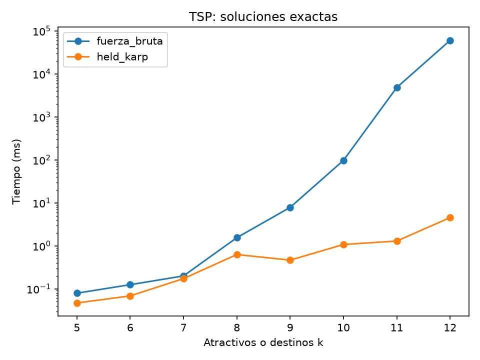

# 5. R4 — Ruta óptima de recorrido

## 5.1 Problema (TSP asimétrico)

La partida se mantiene fija; se visitan k lugares y se regresa minimizando la suma
de tiempos de la matriz R2. La matriz es dirigida: invertir un recorrido puede
cambiar su costo. Los índices de `lugares` remiten a filas y columnas del catálogo;
no necesitan ser consecutivos. Las visitas turísticas se suman después de ordenar:
para un conjunto fijo, su duración no depende del orden.

## 5.2 Fuerza bruta: complejidad

Se generan las k! permutaciones con intercambios recursivos propios. Cada hoja suma
los k+1 desplazamientos, incluido el regreso. No se poda ni se identifican recorridos
inversos, pues la matriz es asimétrica. En empate se conserva la primera hoja.
La partida permanece fija y en cada nivel se fija un destino adicional; al regresar,
se deshace el intercambio. Ese invariante permite enumerar cada permutación una vez.

El número de nodos de generación satisface `G(k)=k·G(k−1)+O(k)` y tiene k! hojas.
Sumar cada recorrido completo cuesta Θ(k): tiempo Θ(k·k!). La copia del recorrido,
el mejor recorrido y la pila de profundidad k ocupan O(k). Estas cotas se derivan
del código; la enumeración del TSP se presenta en la guía 09, sección 9.

## 5.3 Held-Karp: subestructura óptima, recurrencia, complejidad y memoria de la tabla

**Subestructura óptima.** Si un camino óptimo parte de p, visita S y termina en j,
y su penúltimo lugar es i, el prefijo hasta i debe ser óptimo para `(S−{j},i)`.
Si hubiera un prefijo más barato, sustituirlo conservaría los mismos lugares y el
último arco i→j y produciría un camino de menor costo, contradicción. Distintos
órdenes comparten estados `(S,j)`, lo que permite reutilizar subproblemas.

Con la partida implícita, `dp[S][j]` guarda el menor costo de visitar S y terminar
en j. Base `dp[{j}][j]=M[p][j]`; transición
`dp[S][j]=min_{i∈S−{j}}(dp[S−{j}][i]+M[i][j])`; cierre
`OPT=min_j(dp[U][j]+M[j][p])`. Se guardan predecesores para reconstruir la ruta.
Las máscaras tienen un bit por posición local, no por índice global del catálogo.
Al quitar un bit se obtiene una máscara menor; recorrerlas crecientemente respeta
las dependencias. En empate se conserva el primer anterior; el cierre considera
finales en el orden de entrada. Dos algoritmos exactos pueden dar rutas distintas
con el mismo costo óptimo.

Hay k·2^k celdas reservadas, incluidas combinaciones sin j∈S. Las transiciones
examinan k(k−1)·2^(k−2) pares válidos para k≥2 y los barridos añaden O(k²·2^k):
tiempo Θ(k²·2^k), inicialización Θ(k·2^k), reconstrucción O(k). Dos arreglos planos
guardan un double y un int por celda: 12·k·2^k bytes de carga útil. La memoria es
Θ(k·2^k), incluida salida; la reconstrucción es iterativa. Se excluyen cabeceras y
alineación de arreglos de la estimación, así como la matriz de entrada compartida.
La recurrencia es por subconjuntos, no de la forma del Teorema Maestro.
La guía 09, sección 9, explica el estado y el orden O(n²·2^n); el conteo anterior y
la estimación corresponden a nuestra implementación con k visitas.

Los tres métodos validan forma de la matriz en O(N) y pesos seleccionados en O(k²),
con memoria constante adicional. Se exige diagonal cero y tiempos finitos no negativos.
Held-Karp limita la resolución a 20 visitas por recursos; el experimento usa hasta 12.

## 5.4 Verificación

Se verificó primero el ejemplo de la guía 09 (costo 80), el contraejemplo voraz
T4-b (óptimo 18, vecino más cercano 23) y una matriz asimétrica cuyo ciclo óptimo
cuesta 3 y el inverso 27. Las pruebas cubren también cero y una visita, índices no
consecutivos, empates, pesos cero, entradas inválidas y desbordamientos. En matrices
aleatorias pequeñas se comparan fuerza bruta y Held-Karp; un oráculo recursivo que
elige destinos mediante un arreglo de usados, sin intercambios, comprueba los exactos
independientemente del generador de permutaciones de producción.

Antes de medir, el servicio valida la matriz y el catálogo y comprueba pertenencia,
unicidad, regreso y suma del recorrido de Held-Karp. Para cada tamaño exacto ejecuta
además fuerza bruta una vez en una JVM aislada, con límite de 300 s; descarta ese
tiempo y exige igualdad de costo antes de iniciar la serie oficial. Tras cada serie
se valida el resultado conservado por el medidor con tolerancia de 10⁻⁶ s. No se
exigen rutas idénticas cuando hay varios óptimos.

Los ocho tamaños reales coincidieron en costo. Las veinte instancias de calidad
también produjeron recorridos válidos, con costo voraz no inferior al óptimo. La
revisión posterior de los CSV contrastó los recorridos de calidad con la matriz R2,
las brechas con su fórmula y las visitas y acumulados del itinerario con el catálogo.
La suite completa aprueba 107 pruebas Java, incluida arquitectura, y 176 Python.

## 5.5 Resultados de las soluciones exactas

Se ejecutó `gradlew.bat bootRun --args=r4` en Windows 11, Java 21.0.10 de Amazon,
12 núcleos lógicos y 23,67 GB de RAM. La JVM usó `-Xms2g -Xmx2g -Xss16m`, sin la
optimización de arranque de desarrollo de Spring Boot. El registro de esta ejecución
está en `results/r4/maquina_java.csv`. Se mide solo la llamada al algoritmo, incluida
su validación y reconstrucción, fuera de lectura, preparación, comunicación y GC.
Cada serie usa una JVM hija, un calentamiento y cinco repeticiones con mediana;
si una ejecución supera 60 s, se conserva únicamente esa ejecución, conforme al
protocolo experimental. El límite por ejecución es 300 s.

Se toma una selección por k de todo el catálogo salvo Armenia, no solo atractivos.
Las instancias no son prefijos anidados: cada tamaño baraja con semilla `2026+k`.
Los ids y semillas se conservan en `results/r4/instancias.csv`.

| k | Fuerza bruta (ms) | Repeticiones | Held-Karp (ms) | Repeticiones |
|---|---:|---:|---:|---:|
| 5 | 0,0790 | 5 | 0,0467 | 5 |
| 6 | 0,1244 | 5 | 0,0683 | 5 |
| 7 | 0,1992 | 5 | 0,1723 | 5 |
| 8 | 1,5439 | 5 | 0,6266 | 5 |
| 9 | 7,8231 | 5 | 0,4642 | 5 |
| 10 | 97,1198 | 5 | 1,0705 | 5 |
| 11 | 4821,8283 | 5 | 1,2904 | 5 |
| 12 | 60136,2287 | 1 | 4,5275 | 5 |

Fuente: `results/r4/exactas.csv`. Ambos métodos completaron hasta k=12, el mayor
tamaño ensayado, sin agotar el límite. No se determinó su máximo tamaño resoluble.
La fila de fuerza bruta k=12 es una sola ejecución de más de un minuto, no la
mediana de cinco muestras.

La separación entre métodos aumenta claramente en los tamaños grandes. Para comparar
con los modelos, los cocientes entre tamaños consecutivos se generan en
`results/r4/cocientes_tiempos.csv`. Si `T_FB(k)≈a·k·k!`, entonces
`T_FB(k)/T_FB(k−1)≈k²/(k−1)`; para `T_HK(k)≈b·k²·2^k`, el cociente es
`2·(k/(k−1))²`. Son referencias del término dominante, no tiempos predichos.

De k=11 a 12, fuerza bruta crece por un factor 12,472 frente a 13,091 del modelo;
de k=10 a 11, el factor observado es 49,648 frente a 12,100. Held-Karp tampoco es
monótono: de k=8 a 9 baja de 0,6266 a 0,4642 ms, y de k=11 a 12 crece por 3,509
frente a 2,380. Las cotas asintóticas describen crecimiento, no obligan a que cada
cociente de esta serie corta coincida con el modelo. El protocolo conserva un solo
calentamiento por JVM; no se aisló el efecto del JIT, de la selección de datos ni del
entorno sobre esas variaciones. No se les atribuye una causa demostrada ni se
eliminan las observaciones que se apartan del modelo.

**Memoria de Held-Karp.** El CSV estima la carga útil de las dos tablas, no el consumo
total medido de la JVM:

| k | Celdas por tabla | Bytes dp + predecesores |
|---|---:|---:|
| 5 | 160 | 1920 |
| 6 | 384 | 4608 |
| 7 | 896 | 10752 |
| 8 | 2048 | 24576 |
| 9 | 4608 | 55296 |
| 10 | 10240 | 122880 |
| 11 | 22528 | 270336 |
| 12 | 49152 | 589824 |

Fuente: `results/r4/memoria_held_karp.csv`, calculado con `12·k·2^k` bytes.
El ahorro de tiempo frente a enumerar permutaciones exige almacenar estados
exponenciales; que estas tablas sean pequeñas para k≤12 no vuelve polinómico el método.

## 5.6 Heurística voraz: elección y justificación

Se eligió vecino más cercano como referencia voraz de bajo costo y fácil interpretación:
en cada paso se va al destino pendiente con menor tiempo desde la posición actual.
Opera directamente sobre `M[actual][j]`, por lo que no requiere simetrizar la matriz
ni cambiar los tiempos dirigidos de R2. Usa las mismas entradas y devuelve el mismo
tipo de recorrido que los exactos, facilitando la comparación. Es determinista con
el orden y el desempate fijados; no necesita parámetros adicionales.

Sus elementos, siguiendo la guía 08 (Universidad del Quindío, 2026, secciones 1 y 6),
son: candidatos = destinos pendientes; selección = menor tiempo desde el actual;
factibilidad = destino no visitado; solución = todos visitados más regreso;
objetivo = minimizar desplazamientos. Como la matriz es completa y finita, cualquier
destino pendiente permite completar un ciclo. Los empates siguen el orden de entrada.
Los barridos suman k+(k−1)+…+1=Θ(k²); visitados y recorrido ocupan O(k).
La decisión local no considera los arcos que quedarán al final: se evalúa su calidad
frente a Held-Karp en lugar de suponer optimalidad.

## 5.7 Calidad de la heurística

Se usaron cinco selecciones por tamaño con partida Armenia y destinos de todas las
categorías. Para la instancia i (1..5), la semilla es `2026+1000·k+i`. La brecha es
`100·(costo_voraz−costo_HK)/costo_HK`, calculada sobre desplazamientos en segundos,
sin duraciones de visita. Los recorridos y costos individuales se conservan en
`results/r4/calidad_detalle.csv`.

| k | Instancias | Brecha promedio (%) | Brecha máxima (%) |
|---|---|---|---|
| 5 | 5 | 5,294 | 9,370 |
| 8 | 5 | 7,148 | 12,771 |
| 10 | 5 | 15,139 | 20,013 |
| 12 | 5 | 14,116 | 19,222 |

Fuente: `results/r4/calidad_heuristica.csv`. El método reduce el trabajo de cómputo,
pero pierde calidad: todas las brechas promedio son positivas. El promedio aumenta
hasta k=10 y disminuye en k=12; no hay crecimiento monótono. Cinco selecciones por
tamaño describen esta muestra, no una garantía de aproximación para otros recorridos.

## 5.8 Itinerario de un día (partida: Armenia, Plaza de Bolívar)

Se seleccionaron Museo del Oro Quimbaya, Jardín Botánico, Valle de Cocora, Colina
Iluminada, Bejuco al Canasto, Parque de la Vida, Calle Real y Alto de la Cruz.
Con los ocho, la jornada óptima suma 827,878 min y supera el límite de 660 min.
Se prueba retirar cada atractivo, se recalcula Held-Karp y se elige la eliminación
que más reduce la jornada; el empate se resuelve por orden de entrada. En esta
selección se retira Cocora: la reducción es 225,552 min y ya no hacen falta más retiros.
La secuencia y las duraciones antes/después están en `results/r4/retiros.csv`.

| Orden | Lugar | Desplazamiento desde el anterior (min) | Visita (min) | Tiempo acumulado (h) |
|---|---|---|---|---|
| 1 | Parque de la Vida | 4,944 | 60 | 1,082 |
| 2 | Museo del Oro Quimbaya | 6,080 | 90 | 2,684 |
| 3 | Mirador Colina Iluminada | 37,634 | 45 | 4,061 |
| 4 | Centro de Interpretación Del Bejuco al Canasto | 2,083 | 45 | 4,846 |
| 5 | Calle Real | 32,574 | 45 | 6,139 |
| 6 | Mirador Alto de la Cruz | 0,865 | 60 | 7,153 |
| 7 | Jardín Botánico del Quindío | 40,931 | 120 | 9,835 |
| 8 (regreso) | Armenia, Plaza de Bolívar | 12,216 | 0 | 10,039 |

Fuente: `results/r4/itinerario.csv`. Totales de `itinerario_resumen.csv`: visitas
465 min, desplazamientos 137,326 min y jornada 602,326 min. Los totales se calculan
con valores sin redondear; la tabla redondea únicamente para presentación.

Se conserva la alerta geométrica de Cocora de R1: su retiro responde a la jornada,
no a mover sus coordenadas ni a ocultar esa alerta. La política de retiro es local:
Held-Karp optimiza el orden del conjunto restante, no el interés turístico ni una
selección global de atractivos. El itinerario modela conducción y visitas; no incorpora
horarios de apertura, tráfico en tiempo real, comidas o acceso desde el nodo vial a la
entrada exacta de cada lugar. Es una jornada factible bajo ese modelo, no una reserva
turística ni una promesa de duración real.

## 5.9 Voraz frente a óptimo (y comparación con Dijkstra)

En T4-b, vecino más cercano produce A→D→C→B→A, con costo
`6+1+9+7=23`. Held-Karp devuelve A→C→D→B→A, de costo `8+1+2+7=18`.
La brecha es 27,778 %. Elegir primero el arco más barato desde A no permite después
usar todos los arcos que convendrían para el ciclo completo, incluido el regreso.

También aparece un contraejemplo real en la primera instancia de calidad k=5:
el óptimo cuesta 13705,471 s y el voraz 13764,125 s, con brecha 0,428 %.
El óptimo visita desde Armenia Decameron Panaca → Las Camelias → Mirador Las
Palmas → Centro de la Guadua → Peñas Blancas → Armenia; el voraz visita esos destinos
en el orden inverso. Son recorridos distintos en una matriz dirigida y no tienen
por qué costar lo mismo. Los ids y costos están en `results/r4/voraz_vs_optimo.csv`.

**Dijkstra hace otra elección.** No elige el vecino más cercano al nodo actual:
selecciona el nodo no fijado con menor distancia provisional acumulada desde el
origen. Con pesos no negativos, si existiera un camino más barato a ese nodo,
el primer nodo aún no fijado de ese camino tendría ya una distancia provisional
no mayor que el costo del camino, estrictamente menor que la elegida. Eso contradice
la selección del mínimo. Su distancia queda definitiva; los prefijos de caminos
mínimos son también mínimos (Sedgewick y Wayne, §4.4; Universidad del Quindío,
2026, guía 08, secciones 5–6; demostración desarrollada en §3.3 de este documento).

En el TSP la regla `min M[actual][j]` no dispone de esa propiedad de elección segura:
restringe los órdenes que aún se pueden completar y no contabiliza todos sus costos
futuros. El problema sí tiene subestructura óptima, como muestra la recurrencia de
Held-Karp, pero esa propiedad por sí sola no justifica la elección de vecino más
cercano. Por eso se conserva como heurística y se informa su brecha frente al exacto.
