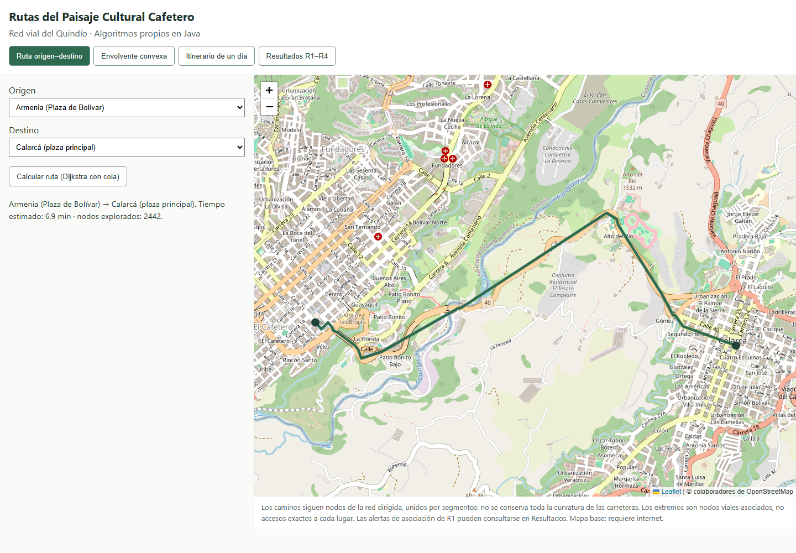
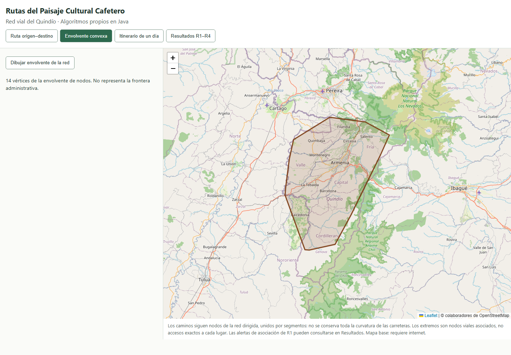
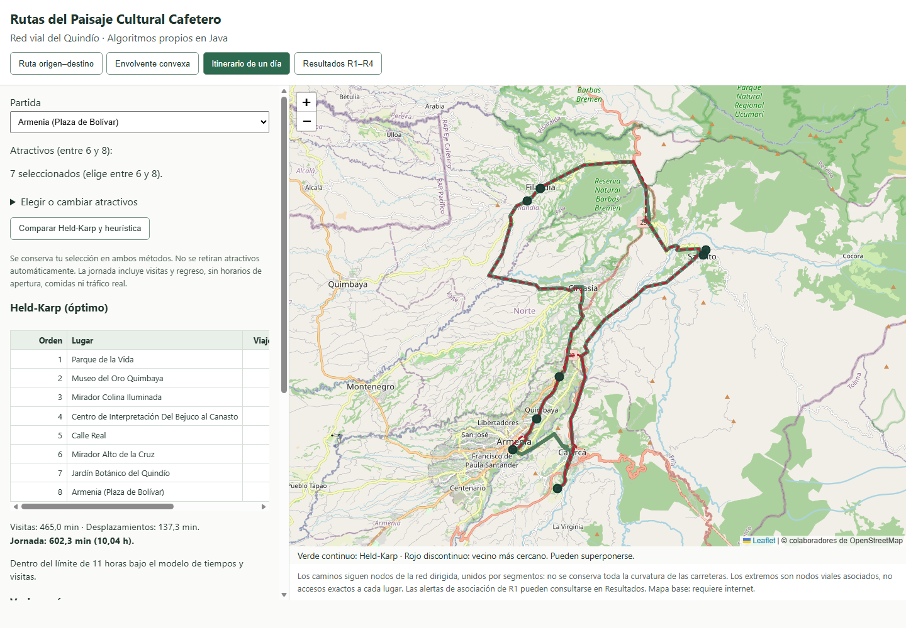
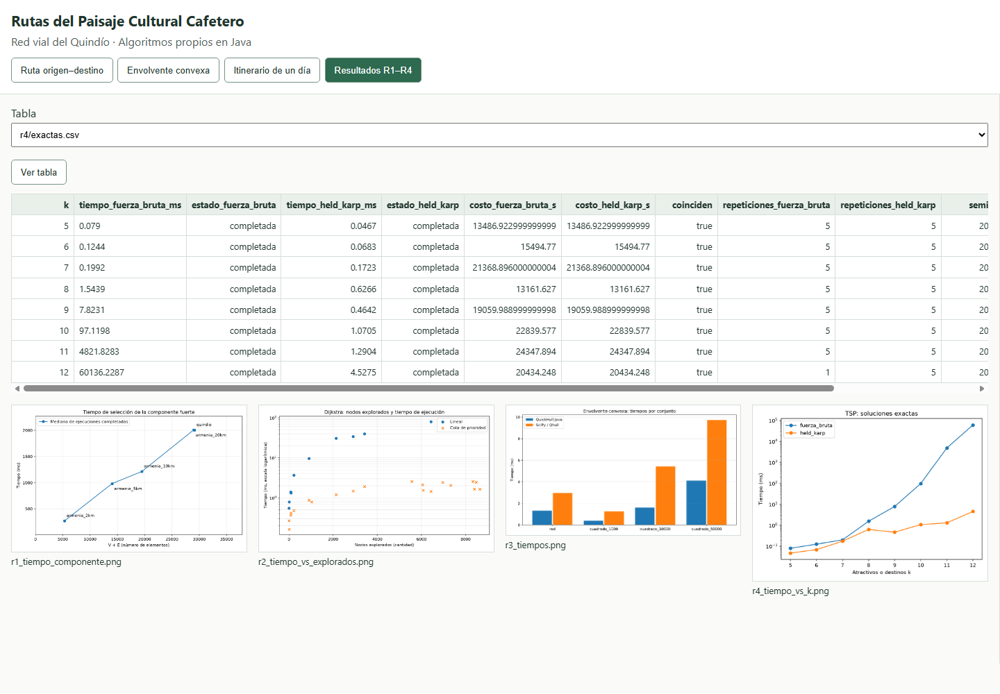

# 6. R5 — Aplicación

## 6.1 Ejecución y arquitectura

La aplicación local usa Spring Boot REST y una página estática con Leaflet 1.9.4.
Desde la raíz se ejecuta `gradlew.bat bootRun` (o `./gradlew bootRun`) y se abre
http://localhost:8080. Requiere JDK 21 y los datos procesados y resultados versionados;
no necesita volver a descargar la red ni repetir los experimentos. El README contiene
los pasos para generar los archivos si faltan. Las dependencias de Gradle se descargan
la primera vez; Leaflet y las teselas del mapa requieren internet.

Se conserva la arquitectura: controladores → servicios → repositorios, con algoritmos
y modelo puros. La página envía solicitudes y representa las respuestas; no ejecuta
Dijkstra ni TSP. Los controladores no abren CSV. `RedService` carga el grafo bajo
demanda una sola vez por proceso y lo reutiliza con acceso sincronizado a la caché;
las búsquedas conservan sus arreglos locales por solicitud.

## 6.2 Ruta entre lugares

Se eligen origen y destino del catálogo y se pulsa **Calcular ruta**. El controlador
llama a `RutaService`: valida los ids, consulta sus asociaciones a nodos, obtiene el
grafo y ejecuta `Dijkstra.colaPrioridad` en ese momento. Devuelve tiempo en segundos,
nodos explorados y coordenadas `[lat, lon]` del camino, que Leaflet representa sobre
OpenStreetMap. La página muestra minutos y ajusta el encuadre al camino.

Origen igual destino o lugares asociados al mismo nodo dan tiempo cero y un punto.
Un destino inalcanzable produce un error de datos, no Infinity en JSON. No se crean
conexiones ni tiempos adicionales entre los lugares del catálogo y sus nodos viales.

El dibujo respeta la secuencia de nodos del camino dirigido. Los CSV exportados no
conservan la geometría curva completa de cada arista: se interpola entre esos nodos.
Por ello el trazo puede apartarse visualmente de algunas curvas de la carretera;
no se presenta como navegación GPS ni como un trazado geométrico exacto de OSM.

## 6.3 Envolvente convexa

**Dibujar envolvente** consulta los vértices geográficos de `r3/envolvente_red.csv`.
No vuelve a ejecutar QuickHull: muestra el resultado del experimento verificado de R3.
El polígono corresponde a la envolvente de los nodos, no a la frontera administrativa.

## 6.4 Comparación de itinerarios

Se seleccionan partida y entre seis y ocho atractivos. Armenia aparece como partida
predeterminada y se precargan los siete atractivos del itinerario final de R4; se
pueden cambiar desplegando **Elegir o cambiar atractivos**. El servidor usa la matriz
R2 para comparar Held-Karp con vecino más cercano sobre la misma selección.
Devuelve orden, viaje, visita y acumulado, incluido el regreso, totales y diferencia
absoluta/porcentual de jornada. Como las visitas son las mismas, la diferencia absoluta
proviene de desplazamientos; el porcentaje de esta pantalla toma como base la jornada
óptima completa, a diferencia de la brecha de calidad de §5.7, basada solo en viajes.

La interfaz solicita después `/api/ruta` para cada par consecutivo de ambos itinerarios,
reutilizando pares coincidentes dentro de la comparación. Dijkstra obtiene los caminos
viales; JavaScript solo agrupa sus coordenadas. Held-Karp se dibuja en verde continuo
y vecino más cercano en rojo discontinuo; algunos tramos pueden superponerse.
Las tablas conservan los totales de la matriz R2 redondeada a tres decimales, mientras
que la geometría proviene de Dijkstra con los pesos del grafo en memoria.

Esta comparación no elimina lugares: si una jornada supera once horas, muestra una
advertencia para ajustar la selección. La política de retiro de `ItinerarioService.planear`
se utiliza en el ejemplo experimental R4; su salida y sus retiros se pueden consultar
en Resultados. Ambas funciones excluyen tráfico en tiempo real, horarios de apertura,
comidas y acceso exacto desde el nodo a la entrada del establecimiento.

## 6.5 Tablas y figuras

La pestaña **Resultados R1–R4** muestra las tablas seleccionadas de `results/` y las
figuras PNG. No las edita ni repite mediciones. Los nombres se validan antes de leerlos:
solo CSV bajo r1–r4 y nombres simples PNG, sin rutas arbitrarias. Las tablas anchas se
desplazan horizontalmente y esta pestaña ocupa todo el ancho de la página.

## 6.6 Errores y verificación

- Solicitudes inválidas, JSON malformado, ids desconocidos o selecciones fuera del
  rango producen HTTP 400 con un campo `error` legible.
- Datos o figuras ausentes producen HTTP 404; cuando corresponde, el mensaje indica
  el comando de generación. Los mensajes no insertan HTML externo sin escapar.
- Las operaciones indican carga. Al cambiar de pestaña o iniciar otra operación se
  aborta la solicitud anterior y se invalida su respuesta para no dibujar datos obsoletos.
- Si falla Leaflet, se informa y siguen disponibles las consultas y tablas. Si fallan
  las teselas, se advierte de la conexión sin alterar los resultados del servidor.

Las pruebas Java incluyen rutas dirigidas, índices, coordenadas, mismo nodo, destino
inalcanzable, caché concurrente, nombres de archivos y solicitudes HTTP sobre un puerto
aleatorio con datos sintéticos. La suite completa aprueba 118 pruebas Java, incluidas
las reglas de arquitectura, y 176 Python. No se cambiaron algoritmos ni resultados
experimentales de R1–R4.

La prueba reproducible `node src/test/javascript/r5-browser.cjs` usa Edge headless
local y CDP sin paquetes adicionales. Con el servidor activo verificó las cuatro
funciones sobre datos reales, figuras, aviso de once horas, selección inválida,
texto externo no ejecutable, respuesta tardía, ancho móvil y Leaflet ausente.
Las capturas de este capítulo provienen de esa ejecución y se revisaron visualmente.
Node y Edge solo se necesitan para esta comprobación de desarrollo, no para usar la app.

La ejecución local y el README están comprobados en el entorno del proyecto. La
reproducción desde cero en una segunda máquina queda como comprobación de entrega
pendiente; las pruebas locales no se presentan como evidencia de un equipo limpio.
